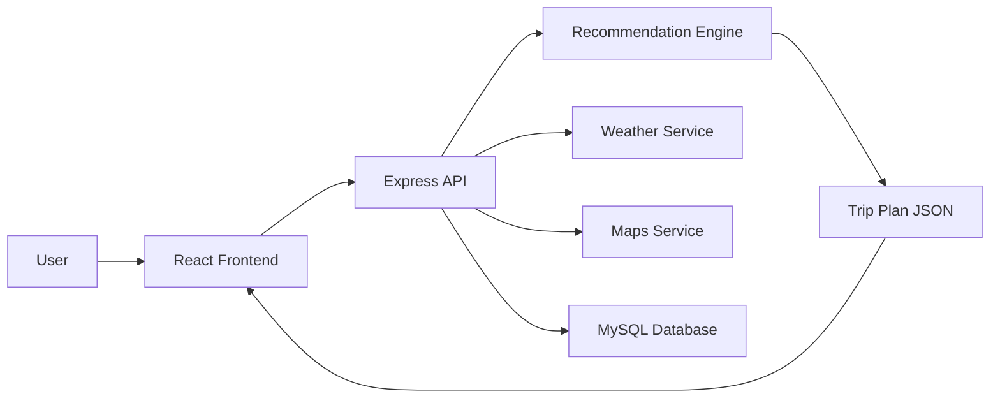

# TripVibe – AI-Powered Smart Tourism & Travel Recommendation System

TripVibe is a complete full-stack travel planning application where users enter their destination, budget, travel vibe, and interests to generate a personalized itinerary with AI-inspired planning, budget suggestions, and destination recommendations.

## Features

- AI-powered trip generation for destination, budget, vibes, and interests
- Multi-step trip planner journey
- Responsive landing page and navigation
- Travel dashboard with save/share flows
- AI travel assistant chatbot
- Destination explorer and detail cards
- Budget planning and optimization suggestions
- Backend API with validation and auth
- Demo/mock data layered for local development when external APIs are unavailable

## Tech Stack

Frontend
- React + TypeScript + Vite
- Tailwind CSS
- React Router
- Lucide icons

Backend
- Node.js
- Express.js
- JWT authentication
- Express validation
- Rate limiting

Database
- MySQL schema design with normalized tables
- Ready for relational storage and future extension

AI / Services
- Recommendation service abstraction
- Weather, maps, and places mock services
- Clear separation between production and mock integrations

## Project Structure

```text
TripVibe/
├── backend/
│   ├── src/
│   │   ├── config/
│   │   ├── data/
│   │   ├── middleware/
│   │   ├── routes/
│   │   ├── services/
│   │   ├── server.js
│   │   └── ...
│   ├── package.json
│   └── .env.example
├── frontend/
│   ├── src/
│   ├── public/
│   ├── vite.config.ts
│   └── package.json
├── database/
│   ├── schema.sql
│   └── seed.sql
├── docs/
│   ├── API_DOCUMENTATION.md
│   └── architecture.md
├── .env.example
├── README.md
└── .gitignore
```

## Local Setup

1. Clone the repository.
2. Copy the root environment file:

```bash
cp .env.example .env
```

3. Install frontend dependencies:

```bash
cd frontend && npm install
```

4. Install backend dependencies:

```bash
cd ../backend && npm install
```

5. Start the backend:

```bash
npm run dev
```

6. Start the frontend:

```bash
cd ../frontend && npm run dev -- --host 0.0.0.0
```

7. Open the app at http://localhost:5173

## Environment Variables

Set the following values in a local .env file:

```env
PORT=5000
JWT_SECRET=your_secret_here
NODE_ENV=development
VITE_API_URL=http://localhost:5000/api
AI_API_KEY=your_ai_key_here
MAPS_API_KEY=your_maps_key_here
WEATHER_API_KEY=your_weather_key_here
PLACES_API_KEY=your_places_key_here
DB_HOST=localhost
DB_PORT=3306
DB_USER=root
DB_PASSWORD=password
DB_NAME=tripvibe
```

## API Flow

- Frontend sends user form input to /api/trips/generate
- Backend calls the recommendation service
- AI engine combines destination, vibe, budget, and weather-aware logic
- Structured JSON trip plan is returned to the UI
- UI renders itinerary, cost breakdown, and AI assistant responses

## Database Setup

For MySQL, initialize schema with:

```sql
CREATE DATABASE tripvibe;
USE tripvibe;
```

Then load the SQL files in the database folder.

## Demo Notes

The project uses mock data for destinations, places, weather, and travel APIs to keep local demonstration reliable without requiring paid third-party credentials. Real API clients can be swapped in later under the service layer without changing the UI.

## Deployment

Use a process manager such as PM2 or deploy the frontend to Vercel/Netlify and the backend to Render, railway.app, or a VPS. Be sure to set env vars securely and keep secrets out of the UI bundle.

## Troubleshooting

- If the backend fails to start, verify Node.js version and .env values.
- If the frontend cannot connect to the API, confirm VITE_API_URL points to the backend server.
- If CORS errors appear, ensure backend CORS is enabled and the server is running.
- If MySQL is unavailable, the app falls back to demo/mock logic for local testing.

## Architecture Overview


